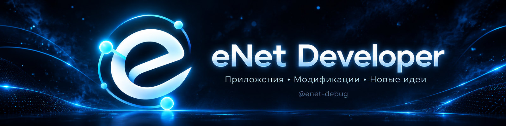
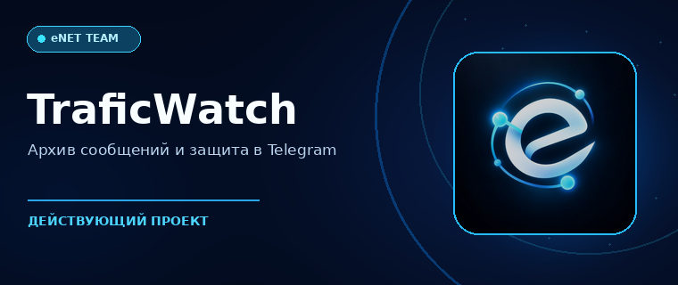
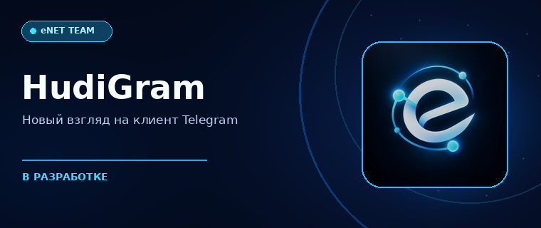
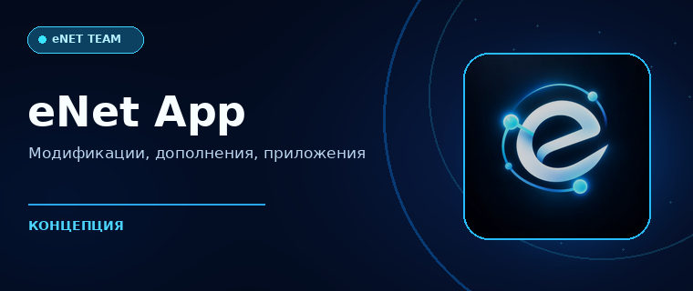

 

### Независимая команда разработчиков

Мы создаём приложения, модификации и инструменты для цифрового мира.  
От первых идей до работающих продуктов — с вниманием к интерфейсам и возможностям.

 

&nbsp;

 

## Проекты eNet

<table>
  <tr>
    <td valign="top" width="50%">
      
      <h3>TraficWatch</h3>
      
Telegram Business-бот: сохранение удалённых сообщений и правок, поиск по архиву и инструменты защиты от мошенников.

      
<strong>Статус:</strong> работает

      
<a href="https://t.me/TraficWatchBot">Открыть бота</a> · <a href="https://t.me/enetwork_dev">Новости команды</a>

    </td>
    <td valign="top" width="50%">
      
      <h3>HudiGram</h3>
      
Альтернативный клиент Telegram с собственным оформлением и дополнительными возможностями. Проект находится в разработке.

      
<strong>Статус:</strong> в разработке

      
<a href="https://t.me/hudigram">Следить за проектом</a>

    </td>
  </tr>
  <tr>
    <td valign="top" width="50%">
      
      <h3>eNet App</h3>
      
Концепция приложения для Windows и iPhone: каталог модификаций, дополнений и продуктов команды с единым визуальным стилем.

      
<strong>Статус:</strong> формирование концепции

    </td>
    <td valign="top" width="50%">
      <h3>eNet Labs</h3>
      
Пространство новых идей, прототипов и экспериментальных разработок команды.

      
Здесь мы исследуем возможности, которые со временем могут стать самостоятельными проектами.

      
<strong>Фокус:</strong> эксперименты, интерфейсы, новые сценарии

    </td>
  </tr>
</table>

## Чем мы занимаемся

<table>
  <tr>
    <td align="center" width="25%"><strong>Приложения</strong> ПК и мобильные устройства</td>
    <td align="center" width="25%"><strong>Модификации</strong> Дополнения и кастомизация</td>
    <td align="center" width="25%"><strong>Telegram</strong> Боты и клиенты</td>
    <td align="center" width="25%"><strong>Эксперименты</strong> Идеи и прототипы</td>
  </tr>
</table>

## Как мы подходим к разработке

**Дизайн.** Интерфейсы должны быть одновременно удобными и узнаваемыми.  
**Функциональность.** Каждая возможность должна решать понятную задачу.  
**Развитие.** Улучшаем действующие продукты и открываем новые направления.

---

<strong>eNet Developer</strong> 
Создаём больше, чем просто программы.

  

<a href="https://t.me/enetwork_dev">Telegram команды</a> · <a href="https://github.com/enet-debug?tab=repositories">Репозитории</a>

  

© 2026 eNet

