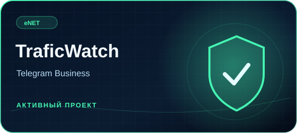
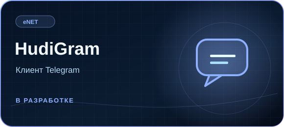
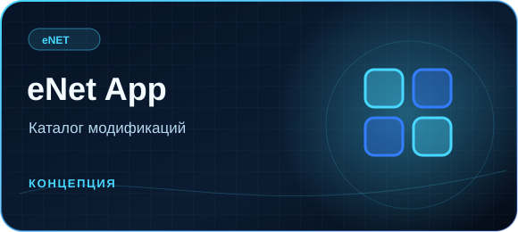

  

**Независимая команда разработчиков цифровых продуктов.**  
Создаём собственные приложения, модификации и инструменты, которыми приятно пользоваться.

 

&nbsp;

 

## Наши проекты

<table>
<tr>
<td width="50%" valign="top">

**TraficWatch**  
Telegram Business-бот для сохранения удалённых сообщений и истории правок, поиска по архиву и дополнительных инструментов безопасности.

🟢 **Работает** · [Открыть бота](https://t.me/TraficWatchBot)

</td>
<td width="50%" valign="top">

**HudiGram**  
Разрабатываемый альтернативный клиент Telegram с собственным интерфейсом и дополнительными возможностями.

🔵 **В разработке** · [Новости проекта](https://t.me/hudigram)

</td>
</tr>
<tr>
<td width="50%" valign="top">

**eNet App**  
Будущее приложение команды с каталогом модификаций, дополнений и собственных продуктов.

⚪ **На стадии концепции**

</td>
<td width="50%" valign="top">

### eNet Labs

Здесь появляются новые идеи и прототипы. Не всё, что мы пробуем, становится отдельным продуктом. Но именно с экспериментов начинается разработка.

**Исследования · Прототипы · Дизайн**

</td>
</tr>
</table>

## Над чем работаем

<table>
<tr>
<td align="center" width="25%"><b>◈</b> <b>Приложения</b> ПК и мобильные устройства</td>
<td align="center" width="25%"><b>▦</b> <b>Модификации</b> Новые возможности</td>
<td align="center" width="25%"><b>◎</b> <b>Telegram</b> Боты и клиенты</td>
<td align="center" width="25%"><b>✧</b> <b>Эксперименты</b> Необычные решения</td>
</tr>
</table>

## Наш подход

**Продуманный интерфейс.** Внешний вид должен помогать, а не мешать.  
**Полезные функции.** Решаем реальные задачи и ищем новые сценарии.  
**Развитие продуктов.** Улучшаем то, что уже выпустили, и пробуем новое.

---

  <b>eNet Developer</b> · Создаём больше, чем просто программы.
   
  © 2026 · <a href="https://t.me/enetwork_dev">Telegram сообщества</a>

